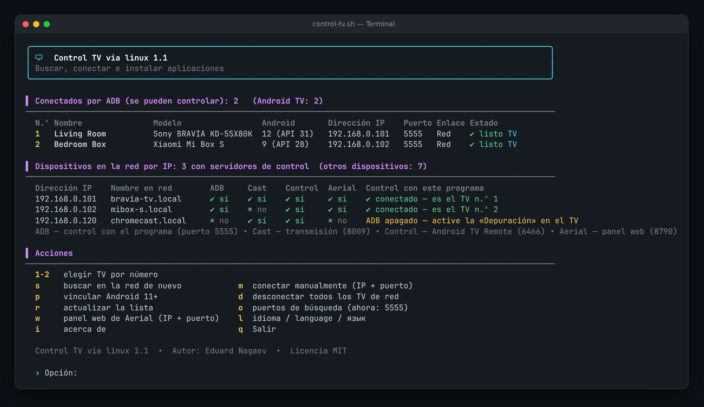
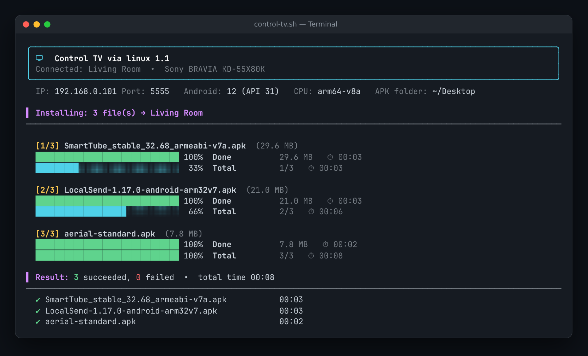
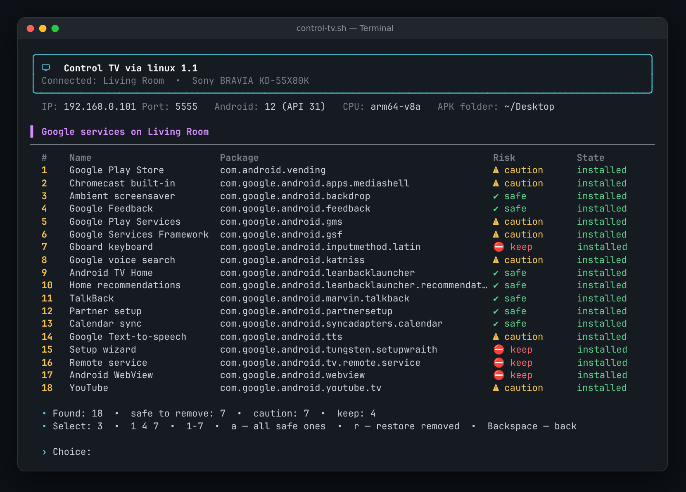

<div align="center">

# 📺 Control TV via linux

**Controle cualquier Android TV desde la terminal de Linux: encuentre los TV en su red, instale APK con barras de progreso, abra apps, cambie el launcher y quite los servicios de Google. Sin root.**

[](LICENSE)


[English](README.md) · **Español** · [Русский](README.ru.md)



</div>

---

## ✨ Para qué sirve

Instalar apps en un Android TV, quitar lo que sobra o cambiar la pantalla de inicio normalmente exige recordar decenas de comandos `adb`. **Control TV via linux** lo convierte todo en un menú claro y colorido en la terminal: elija el TV, elija la acción, listo.

Es para quienes:

- instalan apps desde APK (SmartTube, Kodi, VLC, launchers…);
- quieren un TV más rápido, sin anuncios ni servicios de Google innecesarios;
- cuidan varios televisores: el suyo, el de sus padres, el de sus amigos;
- mantienen vivo un TV antiguo que el fabricante ya no actualiza.

## 🚀 Funciones

| | |
|---|---|
| 🔎 **Búsqueda en la red** | Revisa su red local y muestra cada Android TV: nombre, modelo, versión de Android, IP y puerto. Para cada IP indica qué servidores de control tiene: **ADB**, **Chromecast**, **Android TV Remote**, **panel web de Aerial**. |
| 🔌 **Cualquier conexión** | Automática, manual por IP + puerto, o vinculación por código de la *Depuración inalámbrica* de Android 11+. Funciona con varios TV a la vez: cada comando va solo al TV elegido. |
| 📦 **Instalador de APK** | Un archivo, varios (`1 3 5`, `1-4`) o toda la carpeta. Barras de progreso por archivo y total, tamaño y tiempo, resumen final y errores explicados en lenguaje claro (otro procesador, Android antiguo, firma distinta…). Admite `.apk`, `.apks`, `.apkm`, `.xapk`. |
| 📱 **Aplicaciones** | Apps de terceros y del sistema con versiones y búsqueda. **Abra cualquier app directamente en el TV**, deténgala, desactívela/actívela o desinstálela. |
| 🧹 **Servicios de Google** | Encuentra todos los paquetes de Google y los clasifica: ✔ seguro / ⚠ cuidado / ⛔ no tocar. Quítelos uno por uno o todos los seguros a la vez, y **recupere** cualquiera que haya quitado. Protege el control remoto, el teclado, el asistente de configuración y el launcher actual. |
| 🏠 **Launcher** | Ve todas las pantallas de inicio y cambia la predeterminada (por ejemplo, a un launcher estilo Apple TV). |
| 🖥️ **Panel web de Aerial** | Abre en el navegador el panel web del launcher [Aerial](https://github.com/pengchujin/aerial-tv) (puerto 8790). |
| ℹ️ **Información del TV** | Memoria, almacenamiento, pantalla, plataforma, versión de Android y parche de seguridad, tiempo encendido. |
| 🌐 **3 idiomas** | English (predeterminado), Español, Русский. Se elige al primer inicio y se puede cambiar cuando quiera. |

<details>
<summary><b>📸 Más capturas</b></summary>
<br>

**Instalación de APK**



**Servicios de Google**



</details>

## 📋 Requisitos

- Linux (Ubuntu, Xubuntu, Debian, Mint, Fedora, Arch…) con **bash 4.3+**
- **adb**: `sudo apt install adb` (Debian/Ubuntu) · `sudo dnf install android-tools` (Fedora) · `sudo pacman -S android-tools` (Arch)
- opcional: `unzip` (para `.apks/.apkm/.xapk`), `xdg-open` (para abrir el panel web)
- un Android TV / Google TV con la **depuración USB o por red** activada

## 📥 Instalación

```bash
git clone https://github.com/YOUR_USERNAME/control-tv-via-linux.git
cd control-tv-via-linux
./install.sh
```

Para iniciarlo:

```bash
control-tv
```

O sin instalar:

```bash
chmod +x control-tv.sh && ./control-tv.sh
```

## 📺 Preparar el TV (una vez)

1. **Configuración → Preferencias del dispositivo → Acerca de**: pulse **Compilación** 7 veces para activar las opciones de desarrollador.
2. **Configuración → Preferencias del dispositivo → Opciones para desarrolladores**: active la **Depuración USB** (y la **Depuración por red** si existe).
3. Inicie `control-tv`. Cuando el TV muestre **«¿Permitir la depuración USB?»**, marque **Permitir siempre** y pulse **Aceptar**.

> Android 11+ con *Depuración inalámbrica*: opción **`p`** (vincular con código) y después **`m`** (conectar).

## ⌨️ Controles

| Tecla | Pantalla principal | | Tecla | En los menús |
|---|---|---|---|---|
| `1…N` | elegir un TV | | `1…9` | elegir una acción |
| `s` | buscar en la red de nuevo | | `2` · `1 3 5` · `1-4` · `a` | elegir: uno, varios, rango, todos |
| `m` | conectar manualmente (IP + puerto) | | `/texto` | buscar en la lista de apps |
| `p` | vincular Android 11+ | | `s` | apps de terceros ↔ del sistema |
| `w` | panel web de Aerial | | `r` | quitar ↔ recuperar (servicios de Google) |
| `l` | idioma | | **`Backspace`** | **atrás** |
| `o` · `d` · `r` · `i` · `q` | puertos · desconectar · actualizar · acerca de · salir | | `q` | salir |

## 🧹 Sobre quitar los servicios de Google

Los paquetes se quitan **solo para el usuario** (`pm uninstall --user 0`). No se borra nada de la partición del sistema, así que **todo se puede recuperar** desde el mismo menú (`r`) o con:

```bash
adb shell cmd package install-existing <paquete>
```

| Nivel | Significado | Ejemplos |
|---|---|---|
| ✔ seguro | el TV funciona sin ello | inicio de Google TV / Android TV, recomendaciones, salvapantallas, comentarios, TalkBack, sincronización |
| ⚠ cuidado | se pierde alguna función | Play Store, Play Services (YouTube lo necesita), YouTube, Chromecast, búsqueda por voz |
| ⛔ no tocar | el TV puede dejar de funcionar | servicio del control remoto, teclado, asistente de configuración, WebView, componentes del sistema |

> 💡 Asigne primero un launcher nuevo y luego quite la pantalla de inicio de Google. Un restablecimiento de fábrica o una actualización de firmware recuperan las apps originales.

## 🛠️ Solución de problemas

| Problema | Solución |
|---|---|
| No aparece ningún TV | Compruebe que la depuración esté activada y que el PC y el TV estén en la misma red. Pruebe `m` con la IP del TV. Si una VPN oculta su red, ejecute `CTV_BASES="192.168.1" control-tv`. |
| Estado «confirme en el TV» | Acepte la ventana **Permitir depuración** en el TV (marque *Siempre*) y pulse `r`. |
| `INSTALL_FAILED_NO_MATCHING_ABIS` | El APK es para otro procesador. En TV de 32 bits use la versión `armeabi-v7a` o `universal`. |
| `INSTALL_FAILED_OLDER_SDK` | La app requiere un Android más nuevo que el del TV. |
| Botones del control ya no funcionan | Recupere el último paquete que quitó (`5` → `r`) o actívelo en la lista de apps del sistema. |

## ⚙️ Configuración

Los ajustes se guardan en `~/.config/control-tv/config` (idioma, carpeta de APK, puertos de búsqueda); las direcciones de los TV, en `~/.config/control-tv/history`. Borre el archivo de configuración para volver a ver el selector de idioma.

## ⚠️ Aviso

Este proyecto no está afiliado a Google, Android ni a ningún fabricante de televisores. Úselo en sus propios dispositivos. Quitar paquetes del sistema es bajo su responsabilidad: cada eliminación se puede deshacer, pero revise siempre lo que selecciona.

## 📄 Licencia

[MIT](LICENSE) © 2026 **Eduard Nagaev**
