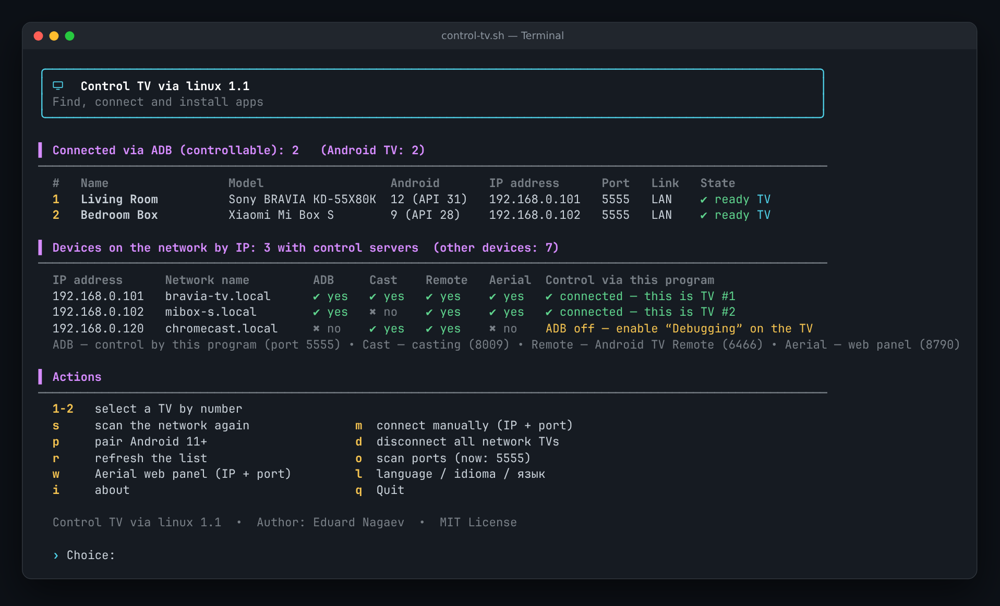
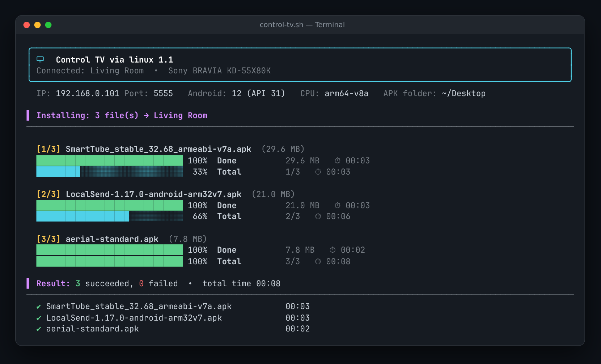
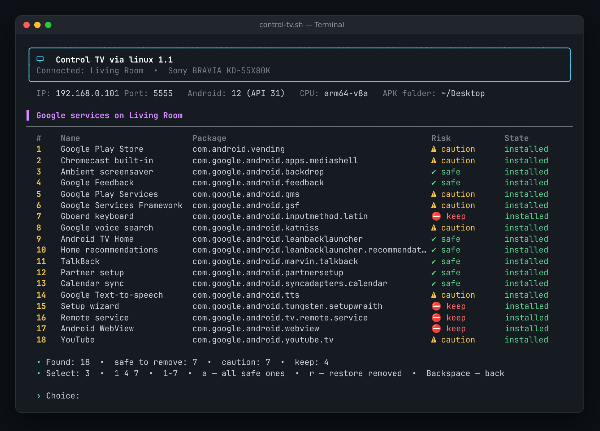
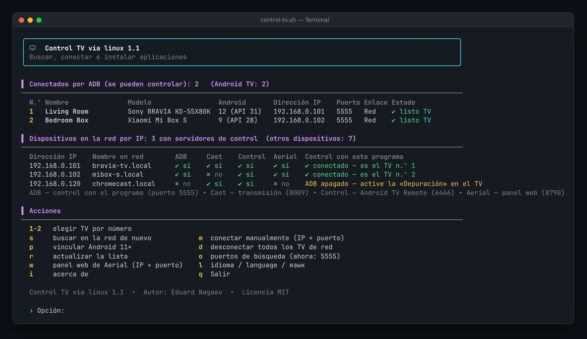
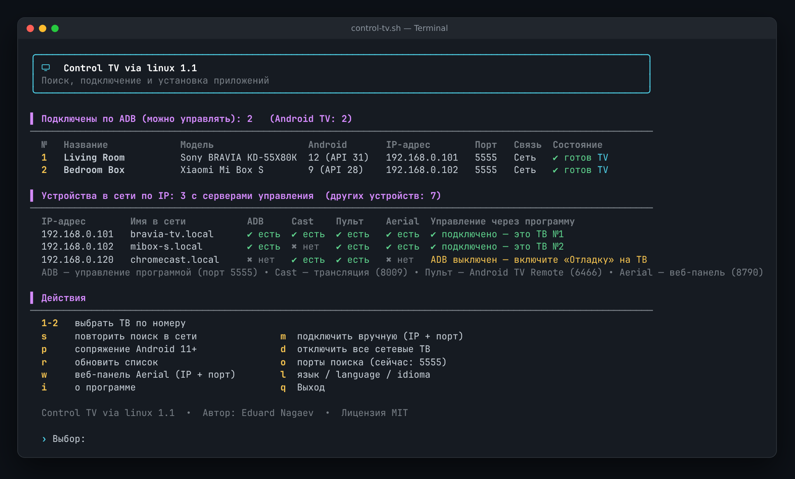

<div align="center">

# 📺 Control TV via linux

**Manage any Android TV from your Linux terminal — find TVs on your network, install APKs with progress bars, open apps, switch launchers and clean out Google services. No root needed.**

[](LICENSE)


**English** · [Español](README.es.md) · [Русский](README.ru.md)



</div>

---

## ✨ Why

Installing apps on an Android TV, removing bloat or changing the home screen usually means memorising dozens of `adb` commands. **Control TV via linux** turns all of that into a clean, colourful menu in your terminal: pick a TV, pick an action, done.

It is made for people who:

- sideload apps (SmartTube, Kodi, VLC, custom launchers…);
- want a faster TV without ads and unnecessary Google services;
- look after several TVs — their own, their parents', their friends';
- keep an old TV alive after the manufacturer stopped updating it.

## 🚀 Features

| | |
|---|---|
| 🔎 **Network discovery** | Scans your LAN and lists every Android TV: name, model, Android version, IP and port. For each IP it shows which control servers are available — **ADB**, **Chromecast**, **Android TV Remote**, **Aerial web panel**. |
| 🔌 **Connect anyhow** | Automatic connection, manual IP + port, or Android 11+ *Wireless debugging* pairing. Works with several TVs at once — every command goes to the selected TV only. |
| 📦 **APK installer** | Install one file, a selection (`1 3 5`, `1-4`) or the whole folder. Per-file and overall progress bars, size and elapsed time, a final summary and plain-language error explanations (wrong CPU, old Android, signature mismatch…). Supports `.apk`, `.apks`, `.apkm`, `.xapk`. |
| 📱 **Apps** | Third-party and system apps with versions and search. **Open any app on the TV**, stop it, disable/enable or uninstall it. |
| 🧹 **Google services** | Finds every Google package and rates it ✔ safe / ⚠ caution / ⛔ keep. Remove selectively or all safe ones at once, and **restore** anything you removed. Protects the remote, keyboard, setup and the current launcher. |
| 🏠 **Launcher** | See all home-screen apps and switch the default one (e.g. to an Apple-TV-style launcher). |
| 🖥️ **Aerial web panel** | Opens the [Aerial](https://github.com/pengchujin/aerial-tv) launcher's web panel (port 8790) in your browser. |
| ℹ️ **Device info** | Memory, storage, screen, platform, Android version and security patch, uptime. |
| 🌐 **3 languages** | English (default), Español, Русский — chosen on first run, change any time. |

<details>
<summary><b>📸 More screenshots</b></summary>
<br>

**Installing APKs**



**Google services manager**



**Español / Русский**

 

</details>

## 📋 Requirements

- Linux (Ubuntu, Xubuntu, Debian, Mint, Fedora, Arch…) with **bash 4.3+**
- **adb** — `sudo apt install adb` (Debian/Ubuntu) · `sudo dnf install android-tools` (Fedora) · `sudo pacman -S android-tools` (Arch)
- optional: `unzip` (for `.apks/.apkm/.xapk`), `xdg-open` (to open the web panel)
- an Android TV / Google TV with **USB or network debugging** enabled

## 📥 Installation

```bash
git clone https://github.com/YOUR_USERNAME/control-tv-via-linux.git
cd control-tv-via-linux
./install.sh
```

Then run:

```bash
control-tv
```

Or run it without installing:

```bash
chmod +x control-tv.sh && ./control-tv.sh
```

## 📺 Prepare the TV (once)

1. **Settings → Device Preferences → About** → press **Build** 7 times to unlock developer options.
2. **Settings → Device Preferences → Developer options** → turn on **USB debugging** (and **Network debugging** if present).
3. Start `control-tv`. When the TV shows **“Allow USB debugging?”**, tick **Always allow** and press **OK**.

> Android 11+ with *Wireless debugging*: use option **`p`** (pair with code) and then **`m`** (connect).

## ⌨️ Controls

| Key | Main screen | | Key | In menus |
|---|---|---|---|---|
| `1…N` | select a TV | | `1…9` | choose an action |
| `s` | scan the network again | | `2` · `1 3 5` · `1-4` · `a` | pick items (one, several, range, all) |
| `m` | connect manually (IP + port) | | `/text` | search in app lists |
| `p` | pair Android 11+ | | `s` | switch third-party ↔ system apps |
| `w` | Aerial web panel | | `r` | switch remove ↔ restore (Google services) |
| `l` | language | | **`Backspace`** | **back** |
| `o` · `d` · `r` · `i` · `q` | ports · disconnect · refresh · about · quit | | `q` | quit |

## 🧹 About removing Google services

Packages are removed **for the current user only** (`pm uninstall --user 0`). Nothing is deleted from the system partition, so **everything can be restored** from the same menu (`r`) or with:

```bash
adb shell cmd package install-existing <package>
```

| Level | Meaning | Examples |
|---|---|---|
| ✔ safe | not needed for the TV to work | Google TV / Android TV home, recommendations, screensaver, feedback, TalkBack, sync |
| ⚠ caution | removing disables a feature | Play Store, Play Services (YouTube needs it), YouTube, Chromecast, voice search |
| ⛔ keep | the TV may break without it | remote service, keyboard, setup wizard, WebView, system components |

> 💡 Set a new launcher **before** removing the Google home screen. A factory reset or firmware update restores the original apps.

## 🛠️ Troubleshooting

| Problem | Solution |
|---|---|
| No TVs found | Check that debugging is on and the PC and TV are on the same network. Try `m` with the TV's IP. A VPN can hide your LAN — run `CTV_BASES="192.168.1" control-tv`. |
| State: *confirm on TV* | Accept the **Allow debugging** prompt on the TV (tick *Always*) and press `r`. |
| `INSTALL_FAILED_NO_MATCHING_ABIS` | The APK is for another CPU. Use the `armeabi-v7a` or `universal` build for 32-bit TVs. |
| `INSTALL_FAILED_OLDER_SDK` | The app needs a newer Android than the TV has. |
| Remote buttons stopped working | Restore the package you removed last (`5` → `r`), or re-enable it in the system apps list. |

## ⚙️ Configuration

Settings are stored in `~/.config/control-tv/config` (language, APK folder, scan ports); known TV addresses are kept in `~/.config/control-tv/history`. Delete the config file to see the language selector again.

## ⚠️ Disclaimer

This project is not affiliated with Google, Android or any TV manufacturer. Use it on devices you own. Removing system packages is at your own risk — every removal can be undone, but always check what you select.

## 📄 License

[MIT](LICENSE) © 2026 **Eduard Nagaev**
