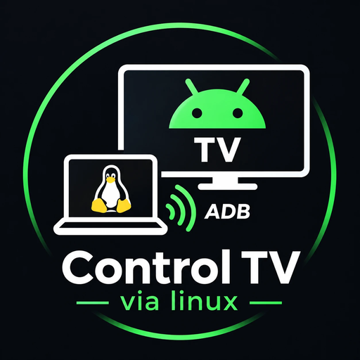
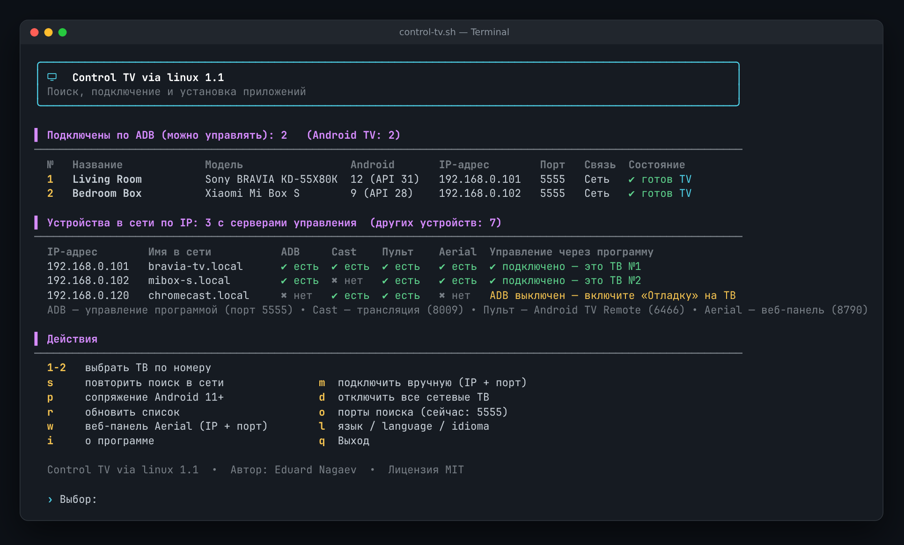
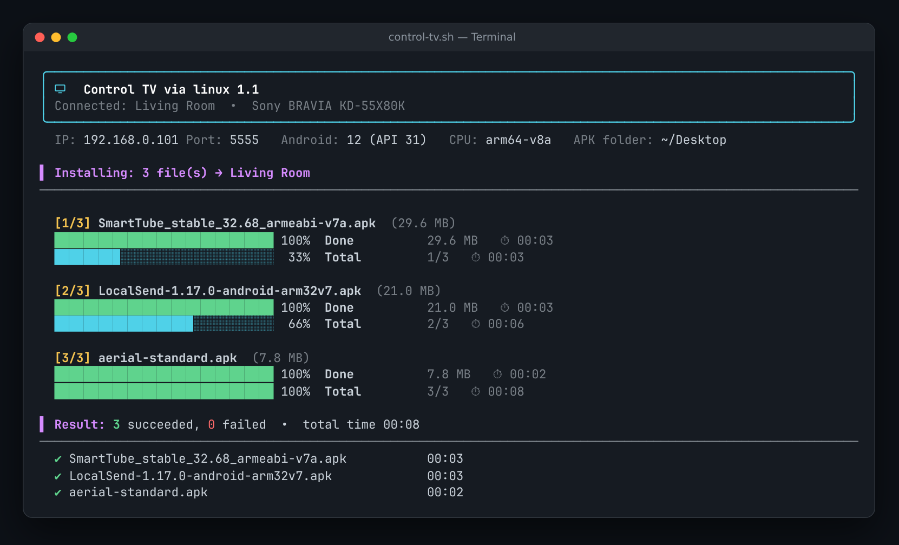
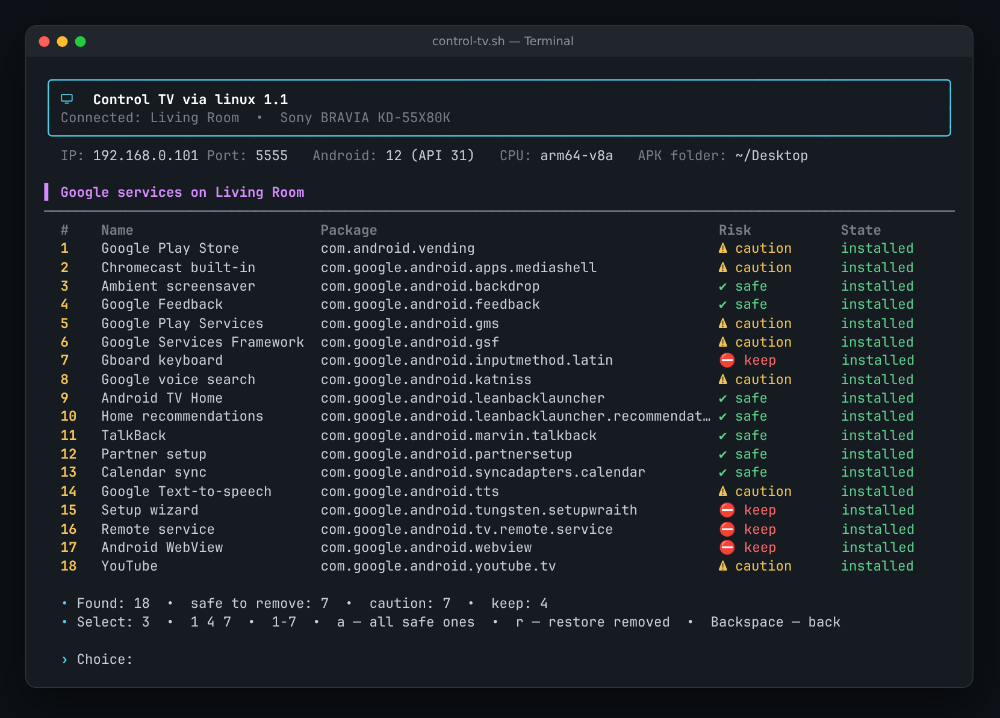

<div align="center">



# Control TV via linux

**Управляйте любым Android TV из терминала Linux: поиск ТВ в сети, установка APK с прогресс-баром, запуск приложений, смена лаунчера и очистка от сервисов Google. Без рута.**

[](LICENSE)


[English](README.md) · [Español](README.es.md) · **Русский**



</div>

---

## ✨ Для чего это нужно

Чтобы установить приложение на Android TV, убрать лишнее или сменить главный экран, обычно приходится помнить десятки команд `adb`. **Control TV via linux** превращает всё это в понятное цветное меню в терминале: выбрали телевизор, выбрали действие, готово.

Программа пригодится, если вы:

- ставите приложения из APK (SmartTube, Kodi, VLC, сторонние лаунчеры…);
- хотите, чтобы ТВ работал быстрее, без рекламы и лишних сервисов Google;
- обслуживаете несколько телевизоров: свой, родителей, друзей;
- поддерживаете старый ТВ, для которого производитель больше не выпускает обновлений.

## 🚀 Возможности

| | |
|---|---|
| 🔎 **Поиск в сети** | Просматривает домашнюю сеть и показывает все Android TV: название, модель, версию Android, IP и порт. Для каждого IP видно, какие серверы управления там есть: **ADB**, **Chromecast**, **Android TV Remote**, **веб-панель Aerial**. |
| 🔌 **Любое подключение** | Автоматически, вручную по IP и порту, или через «Беспроводную отладку» Android 11+ с кодом. Можно работать с несколькими ТВ сразу: каждая команда уходит только выбранному. |
| 📦 **Установка APK** | Один файл, несколько (`1 3 5`, `1-4`) или вся папка. Прогресс-бар по каждому файлу и общий, размер и время, итоговая таблица, понятное объяснение ошибок (не тот процессор, старый Android, другая подпись…). Поддерживаются `.apk`, `.apks`, `.apkm`, `.xapk`. |
| 📱 **Приложения** | Сторонние и системные приложения с версиями и поиском. **Можно открыть любое приложение прямо на ТВ**, а также остановить, отключить/включить или удалить его. |
| 🧹 **Сервисы Google** | Находит все пакеты Google и помечает их: ✔ безопасно / ⚠ осторожно / ⛔ не трогать. Удаление выборочно или всех безопасных сразу, **возврат** любого удалённого. Пульт, клавиатуру, мастер настройки и текущий лаунчер программа удалить не даст. |
| 🏠 **Лаунчер** | Список всех главных экранов и смена основного (например, на лаунчер в стиле Apple TV). |
| 🖥️ **Веб-панель Aerial** | Открывает в браузере веб-панель лаунчера [Aerial](https://github.com/pengchujin/aerial-tv) (порт 8790). |
| ℹ️ **Сведения о ТВ** | Память, хранилище, экран, платформа, версия Android и патч безопасности, время работы. |
| 🌐 **3 языка** | English (по умолчанию), Español, Русский. Язык выбирается при первом запуске, сменить можно в любой момент. |

<details>
<summary><b>📸 Ещё скриншоты</b></summary>
<br>

**Установка APK**



**Сервисы Google**



</details>

## 📋 Требования

- Linux (Ubuntu, Xubuntu, Debian, Mint, Fedora, Arch…) с **bash 4.3+**
- **adb**: `sudo apt install adb` (Debian/Ubuntu) · `sudo dnf install android-tools` (Fedora) · `sudo pacman -S android-tools` (Arch)
- по желанию: `unzip` (для `.apks/.apkm/.xapk`), `xdg-open` (чтобы открыть веб-панель)
- Android TV / Google TV с включённой **отладкой по USB или по сети**

## 📥 Установка

```bash
git clone https://github.com/YOUR_USERNAME/control-tv-via-linux.git
cd control-tv-via-linux
./install.sh
```

Запуск:

```bash
control-tv
```

Или без установки:

```bash
chmod +x control-tv.sh && ./control-tv.sh
```

## 📺 Подготовка ТВ (один раз)

1. **Настройки → Настройки устройства → Об устройстве**: 7 раз нажмите **Сборка**, чтобы открыть режим разработчика.
2. **Настройки → Настройки устройства → Для разработчиков**: включите **Отладку по USB** (и **Отладку по сети**, если такой пункт есть).
3. Запустите `control-tv`. Когда на ТВ появится окно **«Разрешить отладку?»**, отметьте **«Всегда»** и нажмите **OK**.

> Android 11+ с «Беспроводной отладкой»: пункт **`p`** (сопряжение по коду), затем **`m`** (подключение).

## ⌨️ Управление

| Клавиша | Главный экран | | Клавиша | В меню |
|---|---|---|---|---|
| `1…N` | выбрать ТВ | | `1…9` | выбрать действие |
| `s` | повторить поиск в сети | | `2` · `1 3 5` · `1-4` · `a` | выбор: один, несколько, диапазон, все |
| `m` | подключить вручную (IP + порт) | | `/текст` | поиск в списке приложений |
| `p` | сопряжение Android 11+ | | `s` | сторонние ↔ системные приложения |
| `w` | веб-панель Aerial | | `r` | удаление ↔ возврат (сервисы Google) |
| `l` | язык | | **`Backspace`** | **назад** |
| `o` · `d` · `r` · `i` · `q` | порты · отключить · обновить · о программе · выход | | `q` | выход |

## 🧹 Об удалении сервисов Google

Пакеты удаляются **только для пользователя** (`pm uninstall --user 0`). Из системного раздела ничего не стирается, поэтому **всё можно вернуть** в том же меню (`r`) или командой:

```bash
adb shell cmd package install-existing <пакет>
```

| Уровень | Что значит | Примеры |
|---|---|---|
| ✔ безопасно | ТВ работает и без этого | главный экран Google TV / Android TV, рекомендации, заставка, отчёты, TalkBack, синхронизация |
| ⚠ осторожно | пропадёт какая-то функция | Play Маркет, Play Services (нужны YouTube), YouTube, Chromecast, голосовой поиск |
| ⛔ не трогать | без этого ТВ может сломаться | служба пульта, клавиатура, мастер настройки, WebView, системные компоненты |

> 💡 Сначала назначьте новый лаунчер и только потом удаляйте главный экран Google. Сброс к заводским настройкам или обновление прошивки вернут исходные приложения.

## 🛠️ Если что-то не работает

| Проблема | Решение |
|---|---|
| ТВ не находится | Проверьте, что отладка включена, а ПК и ТВ в одной сети. Попробуйте `m` и IP телевизора. Если мешает VPN, запустите `CTV_BASES="192.168.1" control-tv`. |
| Состояние «подтвердите на ТВ» | Разрешите отладку в окне на ТВ (отметьте «Всегда») и нажмите `r`. |
| `INSTALL_FAILED_NO_MATCHING_ABIS` | APK для другого процессора. Для 32-битных ТВ берите сборку `armeabi-v7a` или `universal`. |
| `INSTALL_FAILED_OLDER_SDK` | Приложению нужен более новый Android, чем на ТВ. |
| Перестали работать кнопки пульта | Верните последний удалённый пакет (`5` → `r`) или включите его в списке системных приложений. |

## ⚙️ Настройки

Настройки хранятся в `~/.config/control-tv/config` (язык, папка APK, порты поиска), адреса ТВ — в `~/.config/control-tv/history`. Чтобы снова увидеть выбор языка, удалите файл настроек.

## ⚠️ Отказ от ответственности

Проект не связан с Google, Android или производителями телевизоров. Используйте его на своих устройствах. Удаление системных пакетов вы выполняете на свой страх и риск: любое удаление можно отменить, но проверяйте, что выбираете.

## 📄 Лицензия

[MIT](LICENSE) © 2026 **Eduard Nagaev**
